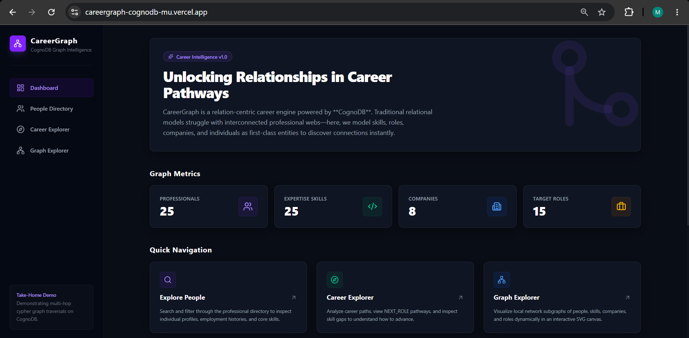
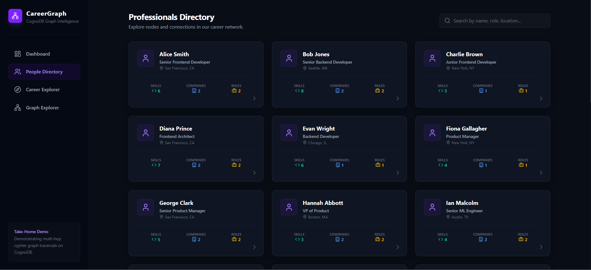
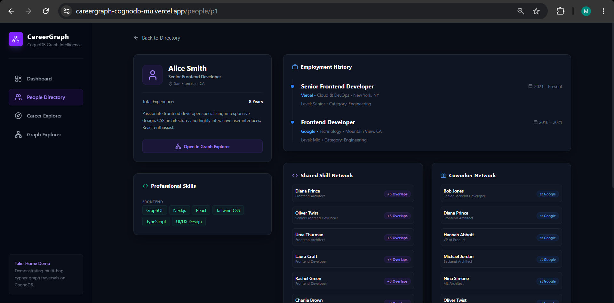
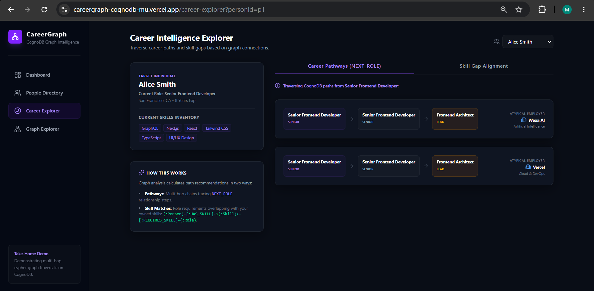
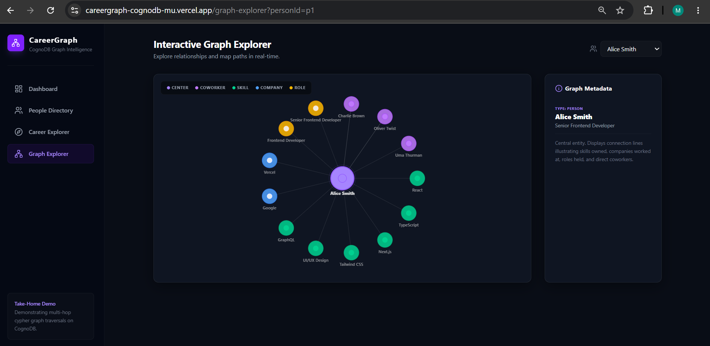
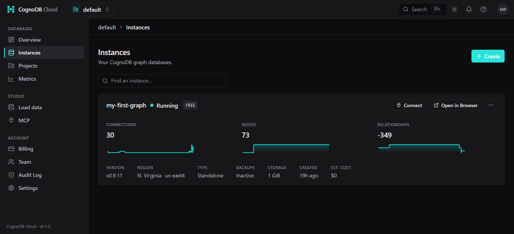
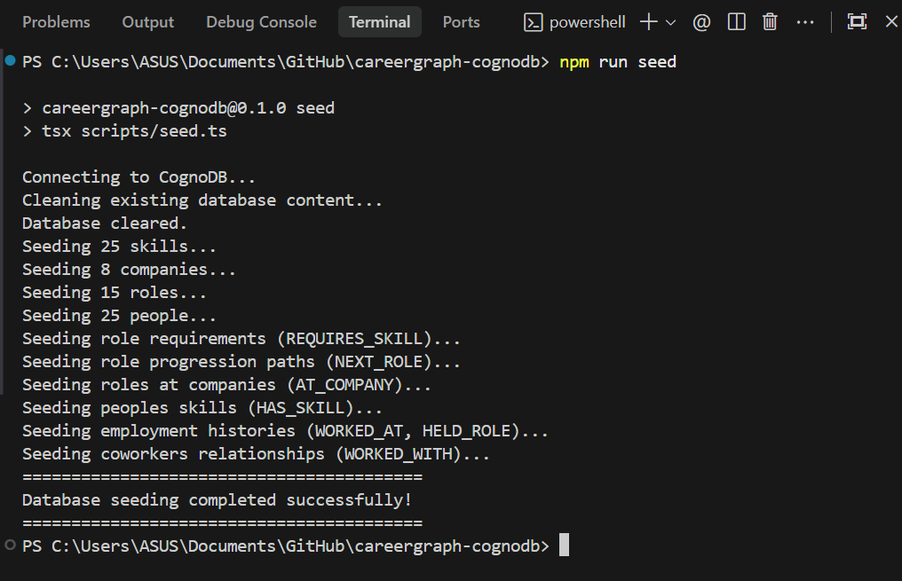

# CareerGraph — Graph-Based Career Intelligence Platform

> A graph-powered career intelligence application that connects professionals, skills, companies, and roles to enable career exploration, skill matching, and relationship discovery.

## 🚀 Live Demo

**Production:**  
https://careergraph-cognodb-mu.vercel.app

**GitHub Repository:**  
https://github.com/Milansojitra9018/careergraph-cognodb

---

## 📌 Overview

CareerGraph is a graph-based career intelligence platform built to demonstrate how professional data can be modeled, queried, and explored using a graph database.

Instead of treating professionals, skills, companies, and roles as isolated records, CareerGraph represents them as an interconnected graph.

This enables the application to explore questions such as:

- Which skills does a professional have?
- Which roles match a professional's existing skills?
- Which companies has a professional worked with?
- Which professionals have worked together?
- What career paths can be explored from an existing role?
- Which skills are required for a target role?
- How are professionals, skills, companies, and roles connected?

The application uses **CognoDB** as the graph database and the official **Neo4j JavaScript driver** for database connectivity and Cypher execution.

---

# 🎯 Why a Graph Database?

Career data is naturally relationship-driven.

A professional is connected to skills, roles, companies, and other professionals. Roles are connected to required skills and possible career progression paths.

A graph database is a strong fit because these relationships are first-class data and can be traversed directly.

For example:

```text
Person
   │
   ├── HAS_SKILL ──────────► Skill
   │                            ▲
   │                            │
   │                       REQUIRES_SKILL
   │                            │
   └── HELD_ROLE ───────────► Role
                                  │
                              NEXT_ROLE
                                  │
                                  ▼
                              Next Role
```

This makes multi-hop career exploration and relationship discovery more natural than modeling the same use case through multiple relational joins.

The graph model is particularly useful for questions that require following several relationships across the dataset.

---

# ✨ Features

## Dashboard

Provides a high-level overview of the graph dataset, including:

- Professionals
- Skills
- Companies
- Roles
- Graph-related metrics

Dynamic business data is retrieved through the application's data/API layer.

---

## People Directory

Browse and explore professionals stored in the graph database.

Capabilities include:

- Professional listing
- Search
- Professional details
- Skills
- Roles
- Company history
- Professional relationships

---

## Person Details

Provides a detailed view of an individual professional and their connected graph data.

Example relationships:

```text
Person
 ├── HAS_SKILL → Skill
 ├── WORKED_AT → Company
 ├── HELD_ROLE → Role
 └── WORKED_WITH → Person
```

---

## Career Explorer

Career Explorer uses graph relationships to explore potential career opportunities and role recommendations.

A typical graph traversal can connect:

```text
Person
   ↓
HAS_SKILL
   ↓
Skill
   ↑
REQUIRES_SKILL
   ↓
Role
```

This allows the application to identify roles that overlap with a professional's existing skills.

---

## Graph Explorer

Graph Explorer provides a visual representation of connected graph data.

Example:

```text
                         ┌─────────────┐
                         │   Company   │
                         └──────▲──────┘
                                │
                           WORKED_AT
                                │
┌─────────────┐          ┌──────┴──────┐
│    Skill    │◄─────────│    Person   │
└──────▲──────┘ HAS_SKILL└──────┬──────┘
       │                         │
       │ REQUIRES_SKILL          │ HELD_ROLE
       │                         ▼
       │                    ┌─────────────┐
       └────────────────────│    Role     │
                            └──────┬──────┘
                                   │
                               NEXT_ROLE
                                   │
                                   ▼
                            ┌─────────────┐
                            │  Next Role  │
                            └─────────────┘
```

This allows users to explore relationships between professionals, skills, companies, and roles.

---

# 🧠 Graph Data Model

CareerGraph uses labeled nodes, typed relationships, and properties to represent career information.

## Node Types

### Person

Represents a professional.

Typical properties include:

```text
id
name
email
location
headline
```

### Skill

Represents a professional skill.

```text
id
name
category
```

### Company

Represents an organization.

```text
id
name
industry
location
```

### Role

Represents a professional role.

```text
id
title
level
category
```

---

## Relationship Types

```text
(:Person)-[:HAS_SKILL]->(:Skill)

(:Person)-[:WORKED_AT]->(:Company)

(:Person)-[:HELD_ROLE]->(:Role)

(:Person)-[:WORKED_WITH]->(:Person)

(:Role)-[:REQUIRES_SKILL]->(:Skill)

(:Role)-[:AT_COMPANY]->(:Company)

(:Role)-[:NEXT_ROLE]->(:Role)
```

These relationships allow the application to perform multi-hop graph traversal rather than relying only on isolated record lookups.

---

# 🏗️ Architecture

```text
┌─────────────────────────────┐
│       Next.js / React       │
│          Frontend           │
└──────────────┬──────────────┘
               │
               │ HTTP / Application Layer
               ▼
┌─────────────────────────────┐
│       Server / API Layer    │
│      Data Access Layer      │
└──────────────┬──────────────┘
               │
               │ Neo4j JavaScript Driver
               ▼
┌─────────────────────────────┐
│           CognoDB           │
│        Graph Database       │
└─────────────────────────────┘
```

The browser does not directly connect to CognoDB.

Database credentials remain server-side and are supplied through environment variables.

---

# 🔎 Main Cypher Queries

The application uses parameterized Cypher queries to retrieve and traverse graph data.

## 1. Skill-Based Career Matching

Example graph traversal:

```cypher
MATCH (p:Person {id: $personId})
      -[:HAS_SKILL]->
      (s:Skill)
      <-[:REQUIRES_SKILL]-
      (r:Role)
RETURN
    r.id AS roleId,
    r.title AS role,
    count(DISTINCT s) AS matchingSkills,
    collect(DISTINCT s.name) AS skills
ORDER BY matchingSkills DESC
```

### What it demonstrates

The query traverses:

```text
Person
   ↓
Skill
   ↓
Role
```

It uses the professional's existing skills to find roles that require those skills.

---

## 2. Career Progression

Example multi-hop traversal:

```cypher
MATCH (p:Person {id: $personId})
      -[:HELD_ROLE]->
      (current:Role)
      -[:NEXT_ROLE*1..3]->
      (next:Role)
RETURN DISTINCT
    current.title AS currentRole,
    next.title AS possibleNextRole
```

### What it demonstrates

This query follows multiple `NEXT_ROLE` relationships to discover potential career progression paths.

```text
Current Role
     ↓
NEXT_ROLE
     ↓
Next Role
     ↓
NEXT_ROLE
     ↓
Future Role
```

This type of multi-hop traversal is a natural fit for a graph database.

---

## 3. Professional Network Exploration

The graph can also be traversed through professional relationships:

```cypher
MATCH (p:Person {id: $personId})
      -[:WORKED_WITH]->
      (colleague:Person)
RETURN
    colleague.id AS colleagueId,
    colleague.name AS colleagueName
```

This exposes professional connections represented directly in the graph.

> The query examples above describe the graph operations demonstrated by the application. Query labels and properties should remain consistent with the implementation.

---

# 🔐 Parameterized Queries & Security

Dynamic query values are passed as parameters instead of being concatenated directly into Cypher strings.

Example:

```cypher
MATCH (p:Person {id: $personId})
RETURN p
```

This keeps application values separate from the Cypher query structure.

The project also keeps database credentials outside the source code.

---

# 🌱 Seed Data

The repository includes a database seed script containing realistic demo data for the CareerGraph use case.

The seed process creates the graph entities and their relationships required by the application.

The goal is to make the project reproducible from a fresh CognoDB instance.

## Seed Flow

```text
Seed Script
     │
     ▼
CognoDB
     │
     ├── Person Nodes
     ├── Skill Nodes
     ├── Company Nodes
     ├── Role Nodes
     │
     └── Relationships
            │
            ▼
      Application Queries
            │
            ▼
        Next.js UI
```

## Run the Seed

Install dependencies:

```bash
npm install
```

Configure the CognoDB environment variables:

```text
.env.local
```

Then run:

```bash
npm run seed
```

After the seed completes successfully, start the application:

```bash
npm run dev
```

---

# ☁️ CognoDB Setup

CareerGraph uses a separate CognoDB instance for graph storage.

## 1. Create a CognoDB Instance

Create a CognoDB Cloud account and provision a free development instance.

## 2. Save Connection Details

After the instance is created, save the generated:

- Connection URI
- Username
- Password

The CognoDB connection URI follows the expected format:

```text
bolt+s://<instance-id>.databases.cognodb.cloud
```

The default CognoDB username is:

```text
cognodb
```

Keep the generated password secure.

## 3. Configure Environment Variables

Create:

```text
.env.local
```

Example:

```env
COGNODB_URI=bolt+s://<instance-id>.databases.cognodb.cloud
COGNODB_USERNAME=cognodb
COGNODB_PASSWORD=<your-password>
```

## 4. Seed the Database

Run:

```bash
npm run seed
```

The seed script loads the demo graph into the configured CognoDB instance.

---

# ⚙️ Environment Variables

The application requires the following environment variables:

| Variable | Description |
|---|---|
| `COGNODB_URI` | CognoDB connection URI |
| `COGNODB_USERNAME` | CognoDB username |
| `COGNODB_PASSWORD` | CognoDB password |

Example:

```env
COGNODB_URI=bolt+s://<instance-id>.databases.cognodb.cloud
COGNODB_USERNAME=cognodb
COGNODB_PASSWORD=<your-password>
```

### Security

Never commit real database credentials to GitHub.

Use:

```text
.env.example
```

for documenting required variable names and placeholders.

Use:

```text
.env.local
```

for local secrets.

Do not expose database credentials through:

```text
NEXT_PUBLIC_*
```

Next.js keeps non-`NEXT_PUBLIC_` environment variables server-side, while variables prefixed with `NEXT_PUBLIC_` are made available to browser-side JavaScript. :contentReference[oaicite:2]{index=2}

---

# 💻 Local Development

## 1. Clone the repository

```bash
git clone https://github.com/Milansojitra9018/careergraph-cognodb.git
```

## 2. Enter the project

```bash
cd careergraph-cognodb
```

## 3. Install dependencies

```bash
npm install
```

## 4. Configure CognoDB

Create:

```text
.env.local
```

and add the required CognoDB credentials.

## 5. Seed the database

```bash
npm run seed
```

## 6. Start the development server

```bash
npm run dev
```

Open:

```text
http://localhost:3000
```

---

# 🧪 Verification Checklist

After setup, verify:

### Database

- [ ] CognoDB connection succeeds
- [ ] Seed script completes successfully
- [ ] Person nodes are available
- [ ] Skill nodes are available
- [ ] Company nodes are available
- [ ] Role nodes are available
- [ ] Relationships are created successfully

### Application

- [ ] Dashboard loads
- [ ] People Directory loads
- [ ] Person Details loads
- [ ] Career Explorer loads
- [ ] Graph Explorer loads
- [ ] Search/filtering works where implemented
- [ ] Graph relationships render correctly
- [ ] Loading states work
- [ ] Empty states work
- [ ] Database/API error states are handled

### Production

- [ ] Production CognoDB instance is configured
- [ ] Production environment variables are configured
- [ ] Production database contains demo data
- [ ] Vercel deployment succeeds
- [ ] Live application URL works
- [ ] No secrets are committed to GitHub

---

# Deployment

The application is deployed on Vercel, while CognoDB is maintained as a separate graph database service.

```text
                    ┌──────────────┐
                    │     User     │
                    └──────┬───────┘
                           │
                           ▼
                    ┌──────────────┐
                    │    Vercel    │
                    │   Next.js    │
                    └──────┬───────┘
                           │
                           ▼
                    ┌──────────────┐
                    │ Server/API   │
                    └──────┬───────┘
                           │
                           ▼
                    ┌──────────────┐
                    │   CognoDB    │
                    └──────────────┘
```

## Vercel Environment Variables

Configure the following in the Vercel project settings:

```text
COGNODB_URI
COGNODB_USERNAME
COGNODB_PASSWORD
```

Use the production CognoDB connection values.

After changing environment variables, redeploy the application so the new configuration is included.

Vercel supports configuring environment variables for deployments through project settings. :contentReference[oaicite:3]{index=3}

---

# Screenshots

## 1. Dashboard

Overview of key career intelligence metrics, including professionals, skills, companies, and roles.



---

## 2. People Directory

Browse and search professionals with their relevant career and skill information.



---

## 3. Person Details

Detailed professional profile showing skills, roles, companies, and connected career information.



---

## 4. Career Explorer

Explore potential career opportunities and role recommendations based on professional skills and graph relationships.



---

## 5. Graph Explorer

Interactive visualization of relationships between professionals, skills, companies, and roles.



---

## 6. CognoDB Graph

Graph database view demonstrating the connected nodes and relationships powering the application.



---

## 7. Seed Success

Successful database seeding demonstrating that the required demo data has been populated into CognoDB.



# Data Flow

Dynamic graph data follows this general flow:

```text
CognoDB
   ↓
Cypher Query
   ↓
Neo4j JavaScript Driver
   ↓
Server / API Layer
   ↓
Application Response
   ↓
React / Next.js UI
```

The seed script provides the initial demo dataset.

CognoDB remains the source of truth for the graph data used by the application.

---

# Engineering Practices

The project follows several production-oriented practices:

- Environment-based database configuration
- Server-side database credentials
- Parameterized Cypher queries
- Clear separation between UI and data access
- Reusable application components
- Seeded demo data
- Graph-oriented data modeling
- Loading and empty states
- Database/API error handling
- Reproducible local setup

---

# Project Structure

```text
careergraph-cognodb/
│
├── public/
│   └── screenshots/
│       ├── 01-dashboard.png
│       ├── 02-people-directory.png
│       ├── 03-person-details.png
│       ├── 04-career-explorer.png
│       ├── 05-graph-explorer.png
│       ├── 06-cognodb.png
│       └── 07-seed-success.png
│
├── scripts/
│   ├── seed.ts
│   └── test-query.ts
│
├── src/
│   ├── app/
│   ├── components/
│   ├── lib/
│   └── types/
│
├── .env.example
├── .gitignore
├── package.json
└── README.md
```

> The exact directory structure may vary slightly depending on the current implementation.

---

# Design Goals

CareerGraph was designed around four core principles:

### Graph-first modeling

Relationships between career entities are treated as first-class data.

### Real database integration

Application data is retrieved from CognoDB through the application's data access layer.

### Reproducible setup

A seed script provides the demo graph required to run and evaluate the application.

### Clear architecture

```text
UI
 ↓
Application / API Layer
 ↓
Data Access
 ↓
CognoDB
```

---

# Author

**Milan Sojitra**

Frontend / Full-Stack Developer

**GitHub:**  
https://github.com/Milansojitra9018

**LinkedIn:**  
https://www.linkedin.com/in/milansojitraa

---